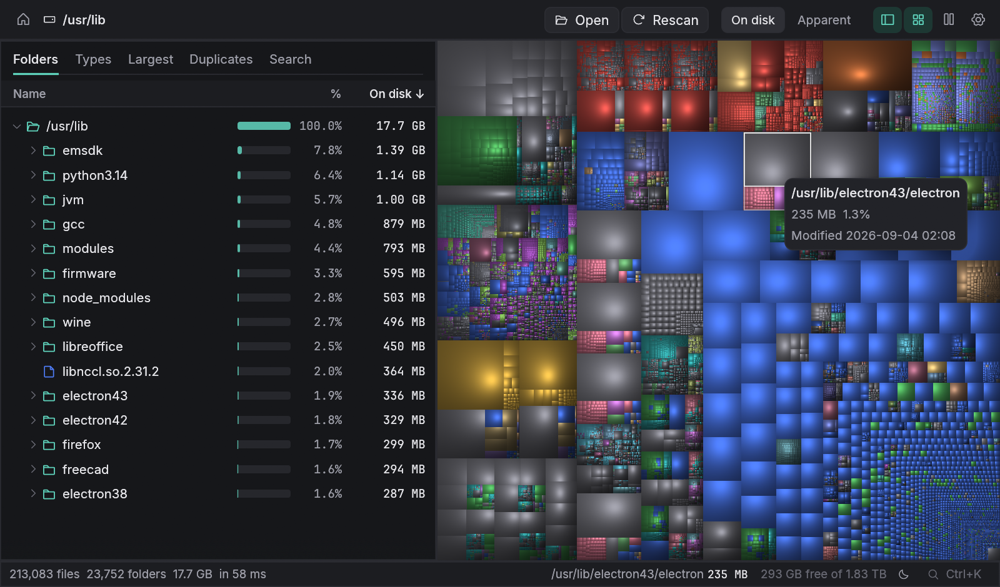

# dirstat

See what takes up space on your disk, then clean it up. A fast WinDirStat for Linux, Windows and macOS.



## Install

Linux (x86_64) and macOS (Apple Silicon):

```bash
curl -fsSL https://raw.githubusercontent.com/pstwh/dirstat/main/install.sh | sh
```

Windows (x64), in PowerShell:

```powershell
irm https://raw.githubusercontent.com/pstwh/dirstat/main/install.ps1 | iex
```

Run it again to update. Builds are also on the [Releases](../../releases) page.

## Use

Pick a drive or a folder. Click a tile to find it in the list, double-click to zoom in, right-click for actions. `Ctrl+K` opens every command, `F1` lists the shortcuts.

```bash
dirstat ~/Downloads        # open and scan a folder
dirstat scan / --top 20    # print the biggest items without a window
```

## Use with Claude

dirstat has an MCP server, so Claude can scan your disks and tell you what uses space and what is safe to clean up. It only reads, it never deletes anything.

```bash
dirstat mcp install claude-code      # or claude-desktop, cursor, vscode, codex, gemini, windsurf
```

Then ask something like "what is taking space on my disk and what can I clean up?".

## Build

```bash
make run
```

Linux needs `libgtk-3-dev libxkbcommon-dev libwayland-dev`.
